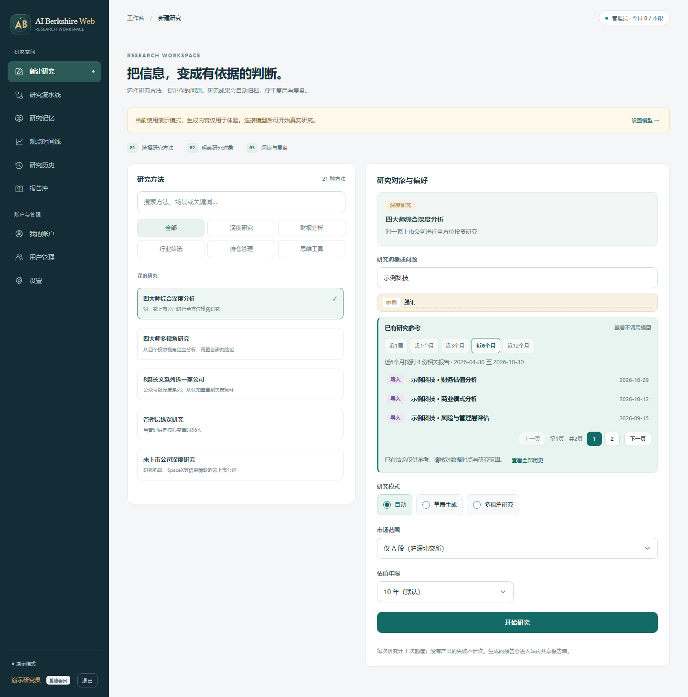
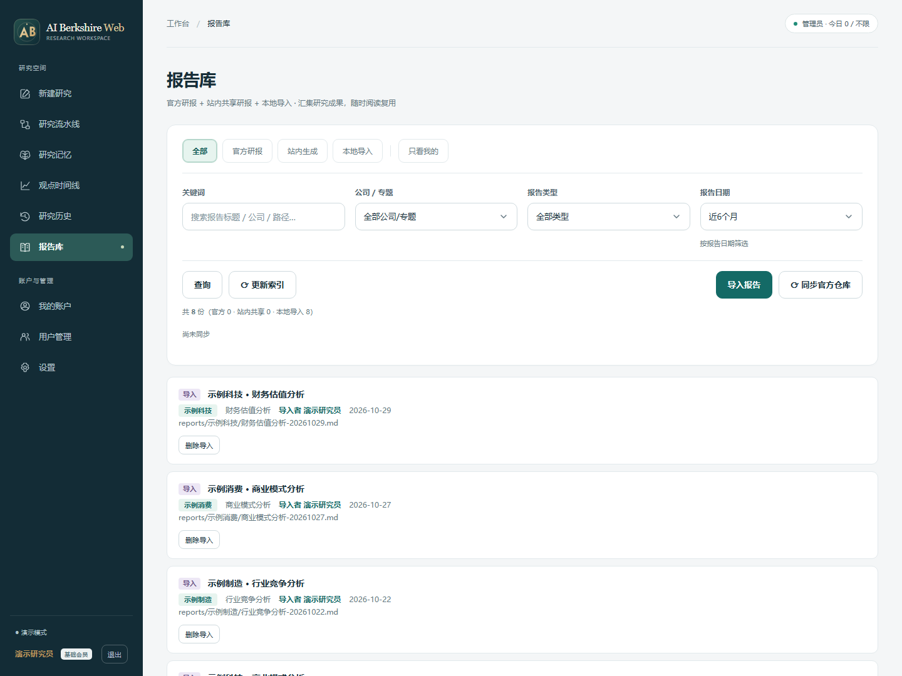
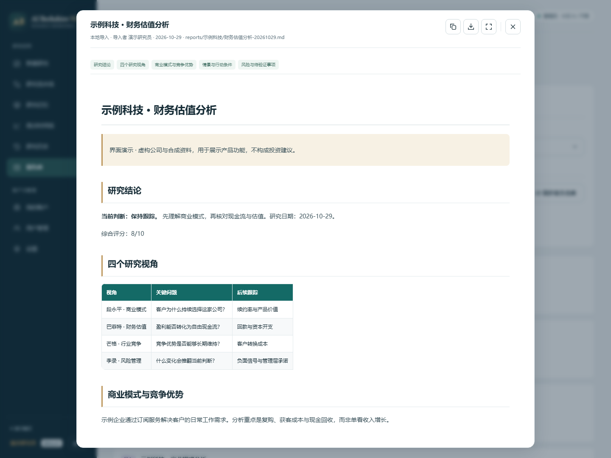
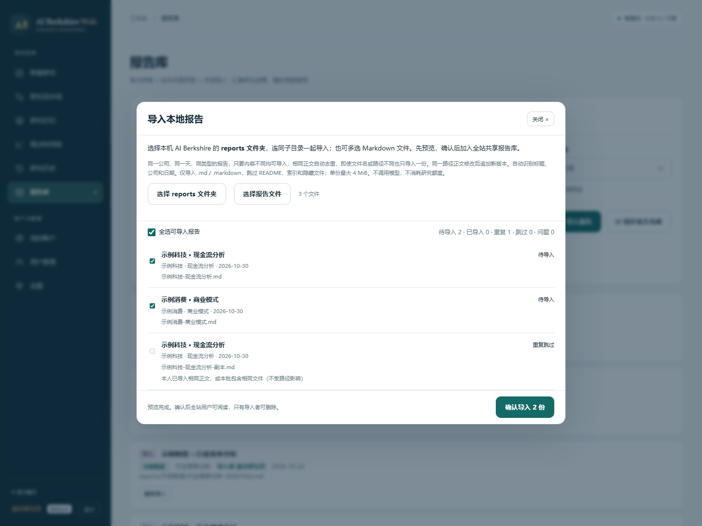
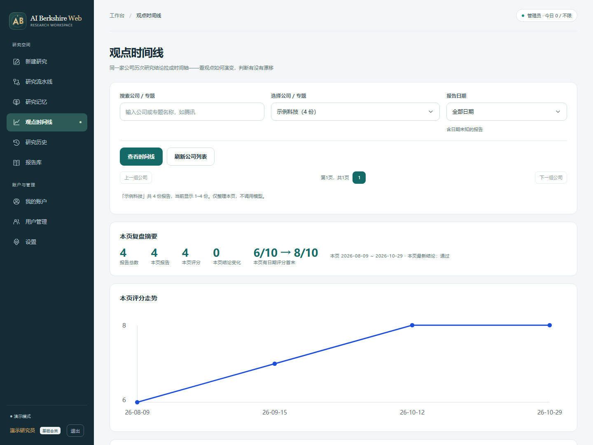
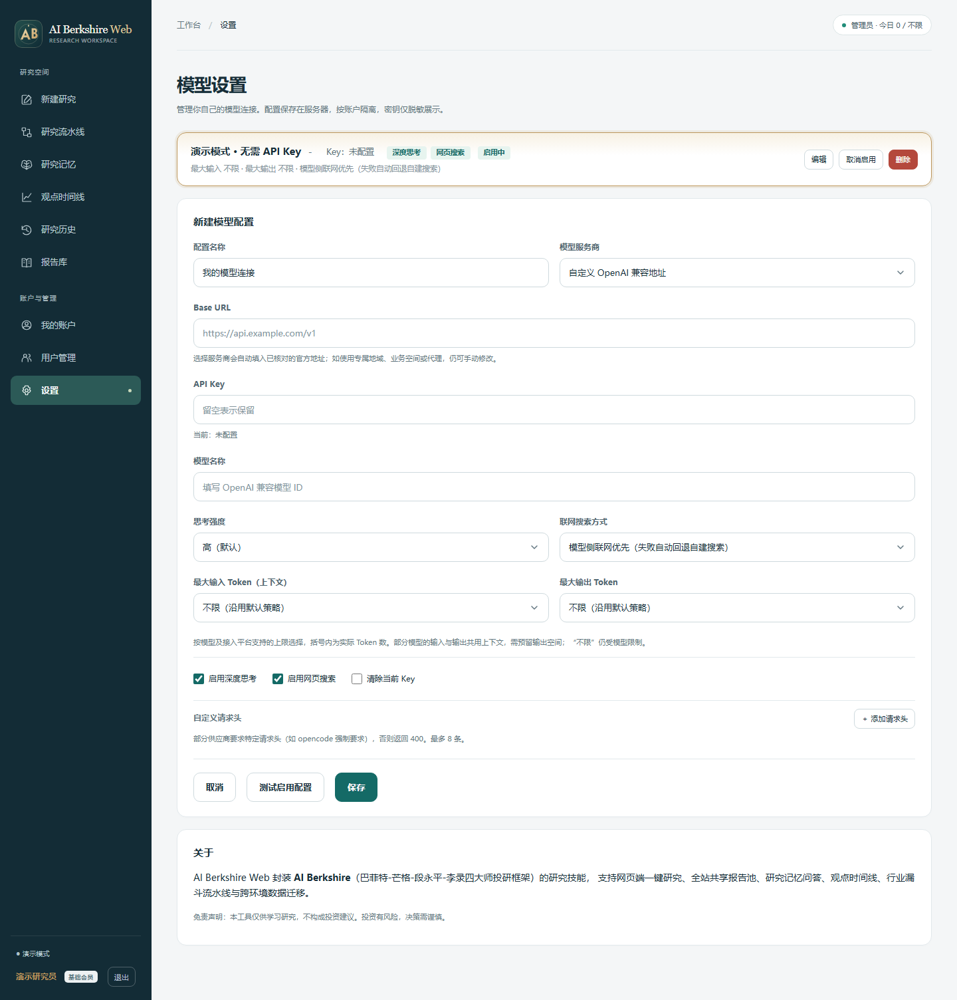
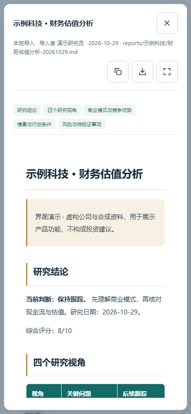

# ai-berkshire-web

**为 [AI Berkshire](https://github.com/xbtlin/ai-berkshire) 封装一层 Web，让你在网页配置 API Key、Base URL 和模型，调用价值投资研究技能，阅读与管理报告。**

本项目的研究方法与技能基础来自 [xbtlin/ai-berkshire](https://github.com/xbtlin/ai-berkshire)。AI Berkshire 将巴菲特、芒格、段永平、李录的投资方法组织成可供 Claude Code / Codex 使用的研究框架；AI Berkshire Web 在此基础上提供网页入口、模型连接配置和报告管理。

> **先认识原项目：[AI Berkshire — AI 时代的价值投资研究框架](https://github.com/xbtlin/ai-berkshire)。** 感谢 [xbtlin](https://github.com/xbtlin) 将这套框架开源。如果这个 Web 版本对你有帮助，也欢迎到上游了解完整方法、支持原作者。

## 为什么做这个 Web 封装

这个项目的起点很直接：AI Berkshire 已经把研究技能开源，希望让更习惯网页的用户也能方便地使用。部署 AI Berkshire Web 后，使用者通过浏览器配置自己的模型 API，选择研究方法、输入问题，再阅读和管理生成结果，无需在使用端操作 Claude Code / Codex 命令行。

- **AI Berkshire 提供研究基础**：价值投资方法、研究技能与相关工具。
- **AI Berkshire Web 提供 Web 使用方式**：模型配置、流式输出、报告阅读与导入，以及多用户账户和额度管理。
- **这是社区适配项目**，并非上游官方 Web 客户端。纯 API 运行会对技能提示词做适配，不具备 Claude Code / Codex 的全部本地工具能力；涉及工具验证的步骤和数据仍需核对，不能把网页输出视为已完成原生 Agent 的全部验算。

源码不包含研报、用户、密码、会话、模型密钥或服务器配置。新安装从空报告库开始，不自动导入仓库文件，也不自动下载研究框架。测试仅使用合成资料。

## 界面预览

以下为真实页面在隔离演示环境中的截图，使用虚构公司、合成内容与演示账户；没有真实研报、私人模型配置或 API Key，也未调用真实模型。新安装不包含图中的演示资料。

### 1. 研究工作台

选择研究方法、填写研究对象，设置市场范围与研究模式。先按日期查阅已有报告，再决定是否发起新研究。



### 2. 报告库

汇集官方报告、站内生成与本地导入内容，按关键词、公司、报告类型和日期筛选，也可以只看自己的报告。



### 3. 阅读与导出

在弹窗中阅读 Markdown 报告，通过目录定位段落，使用右上角图标复制、下载或进入专注阅读。



### 4. 导入本地 reports

选择整个 `reports` 文件夹或多个 Markdown 文件，先预览再确认导入。同公司、同日期、同类型的不同内容可以分别保留；正文完全相同的文件会去重。



### 5. 观点时间线

按公司整理历次报告，查看评分走势与结论变化，再回到原报告核对。图中评分为合成演示数据。



### 6. 网页模型配置

在网页设置自己的服务商、Base URL、API Key、模型名称、思考强度与 Token 上限，保存多个配置并切换。图中的密钥为空。



### 7. 手机阅读

窄屏自动调整导航、按钮和报告排版，便于在手机上查阅与复盘。



## 快速开始

Python 3.10+。从本仓库下载源码，或点击页面上的 Code 获取 Git 克隆地址，然后在项目根目录运行：

```bash
python -m venv .venv
.venv/bin/pip install -r ai-berkshire-web/requirements.txt
export VC_ADMIN_USER=admin
export VC_ADMIN_PASS='replace-with-your-own-strong-password'
.venv/bin/python ai-berkshire-web/run.py
```

Windows PowerShell：

```powershell
python -m venv .venv
.\.venv\Scripts\python.exe -m pip install -r ai-berkshire-web/requirements.txt
$env:VC_ADMIN_USER = 'admin'
$env:VC_ADMIN_PASS = 'replace-with-your-own-strong-password'
.\.venv\Scripts\python.exe ai-berkshire-web/run.py
```

打开 `http://127.0.0.1:8765`。密码示例仅为占位符，请在首次启动前设置自己的密码。已有数据库不会重新创建管理员或覆盖已有密码、角色和配置。

在“设置”中主动添加服务商、地址、模型与密钥；新用户默认演示模式，地址、模型名与密钥为空。外部研究方法可配置 `VC_FRAMEWORK_DIR`，或由管理员在报告库主动同步 [AI Berkshire](https://github.com/xbtlin/ai-berkshire)。同步属于显式的数据下载操作，可能带入上游公开报告。

配置项沿用 `VC_` 前缀，便于兼容已有安装和数据迁移。

## 功能

围绕 AI Berkshire 的研究流程，Web 层提供：

- 研究工作台：方法搜索、市场范围、单篇或多视角流式生成。
- 研究流水线：逐层筛选、清单与深度研究，中断保留已有产出。
- 报告库：导入本机 Markdown、检索与日期筛选、复制、下载和专注阅读。
- 研究记忆与时间线：已有结论检索、带来源问答、历次观点复盘。
- 通用账户：用户与会话、独立管理员角色、可配置会员等级、邀请注册与每日用量。
- 多模型配置：按用户隔离，支持 OpenAI/Anthropic 协议及服务商预设，不预置私人连接。

## 通用平台策略

复制 `platform.example.json` 为 `platform.local.json`，通过 `VC_PLATFORM_CONFIG` 指向它。可配置会员标识与名称、每日额度、默认等级、重置时区、会话期限、邀请期限/上限及用量操作名称。

管理员角色与会员等级独立。默认基础/标准/高级会员分别为 20/200/不限次，管理员不限；`free/vip/svip` 标识用于兼容旧库，可在新部署策略中替换。管理员页面按策略自动生成等级选择与额度表单。

计量单位是操作次数：原子预留、完成计次、无产出失败释放、操作记录独立于报告删除。积分余额或支付可在 `accounts.reserve/finish` 边界扩展；当前没有充值、支付、站点代付或按 Token 自动扣费。

## 数据边界

| 内容 | 保存位置 | 随源码发布 |
|---|---|---|
| 源码、占位示例、合成测试 | `ai-berkshire-web/`、`ops/` | 是 |
| 账号、密钥、会话、研报与用量 | 应用 `VC_DATA_DIR` 的 SQLite 数据库 | 否 |
| 外部研究框架与官方报告 | `VC_FRAMEWORK_DIR` 或 `ai-berkshire/` | 否 |
| 运维 SSH 配置 | 根 `.env.local` | 否 |
| 私人平台策略 | `platform.local.json` | 否 |
| 已审查的合成演示截图 | `docs/screenshots/` | 是 |
| 私人截图、日志、备份、开源导出 | `.local/` 或独立持久目录 | 否 |

应用运行配置示例为 [.env.app.example](.env.app.example)，SSH 运维示例为 [.env.example](.env.example)，用户模型设置保存在数据库；三者独立。源码包中没有 `.env.local`、真实数据库或 Git 历史。研报导出到 Git 的旧入口已停用，数据迁移请使用受限的管理员备份功能。

## 开发与交付

```powershell
.\.venv\Scripts\python.exe -m pip install -r ai-berkshire-web/requirements-dev.txt -r ops/requirements.txt
.\.venv\Scripts\python.exe -m ops.check
```

UI 改动需执行隔离浏览器检查；详见 [运维文档](ops/README.md)。现有安装仍使用本地 SSH 直连、提交后发布与数据连续性验证。GitHub Actions 和 PR 不是必要条件。

开源导出与无历史初始化见 [开源发布指南](docs/OPEN_SOURCE_RELEASE.md)。应用行为见 [应用文档](ai-berkshire-web/README.md)，通用模块边界见 [平台架构](docs/PLATFORM.md)。另见 [安全说明](SECURITY.md) 和 [第三方声明](THIRD_PARTY_NOTICES.md)。

本工具仅供研究学习，生成内容不构成投资建议。

## 致谢与许可

感谢 [AI Berkshire](https://github.com/xbtlin/ai-berkshire) 与原作者 [xbtlin](https://github.com/xbtlin)。本项目因上游的开源而得以实现，研究方法与技能的来源应归于上游；完整方法论、原生 Agent 使用方式和最新技能请查阅原仓库。

AI Berkshire Web 采用 [MIT](LICENSE) 许可；上游署名与许可说明保留在 [第三方声明](THIRD_PARTY_NOTICES.md)。
